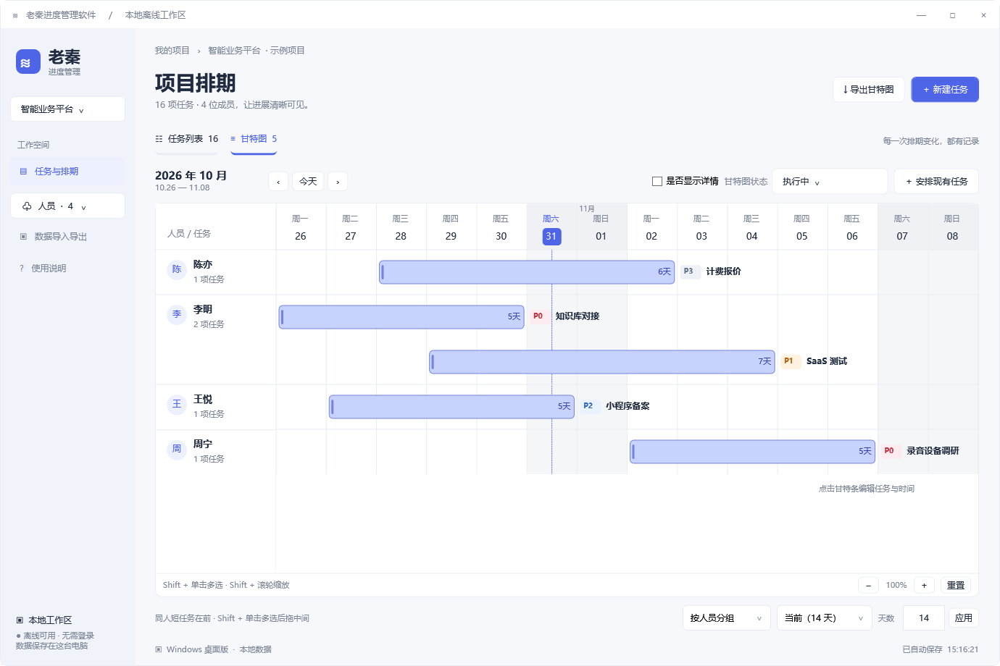
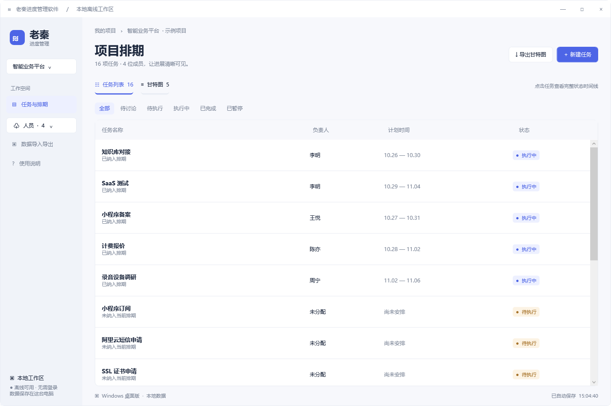
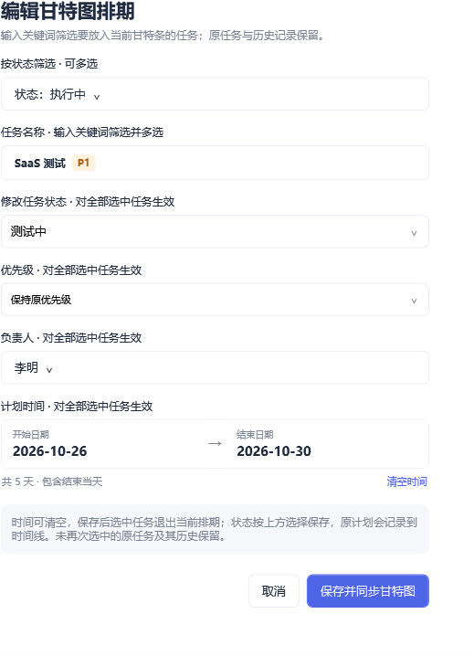
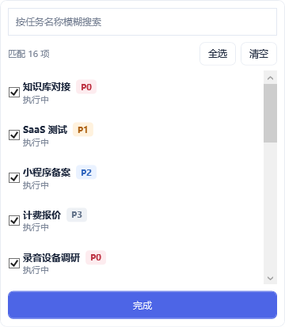
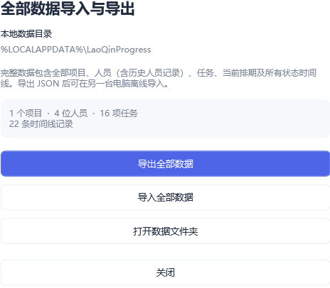
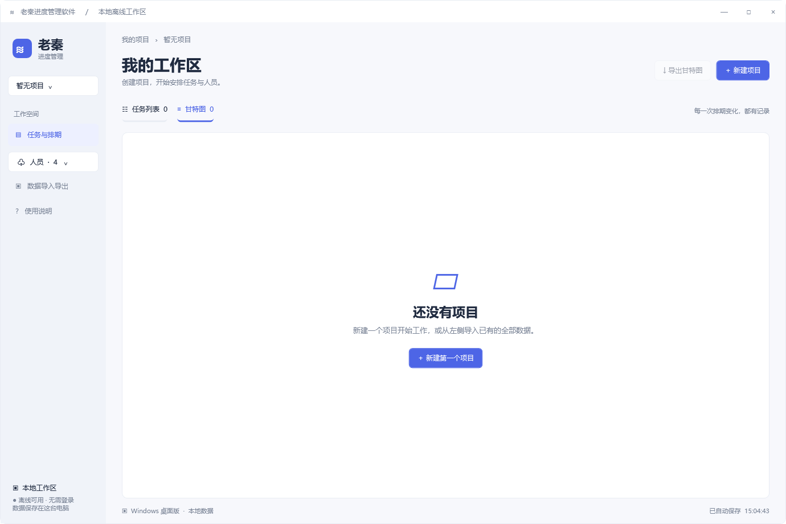

# 老秦进度管理软件

一款面向 Windows 的离线项目与人员排期工具。把任务、负责人、时间范围和每一次状态变化放在一起，让项目进度更清楚。

**当前版本：1.1.4 · 目标系统：Windows 10 / Windows 11 · 完全离线 · Apache-2.0**

无需登录，不依赖服务器。项目、人员、任务、甘特图排期和时间线都保存在本机；解压发行包后，双击 `LaoQinProgressManager.exe` 即可使用。



## 能做什么

| 功能 | 说明 |
| --- | --- |
| 项目管理 | 下拉切换、新增和删除项目；允许一个项目都没有 |
| 按项目清理 | 删除项目时，一并移除其全部任务、甘特图排期和时间线 |
| 轻量人员管理 | 在下拉中新增、选择或删除人员；保留已关联任务的历史人员记录 |
| 任务管理 | 支持执行中、待执行、待讨论、已完成、已暂停和已关闭；列表按此顺序分页显示 |
| 任务时间线 | 按时间串联创建、初始详情、追加需求、状态变更及排期操作 |
| 人员甘特图 | 显示人员、任务、日期与星期，单独标注周六和周日 |
| 多选排期编辑 | 按状态多选筛选，再从现有任务下拉中多选任务，统一调整人员与时间 |
| PDF / 图片 / XML | 支持 A4 横向分页 PDF、PNG 图片及当前项目的 XML 数据 |
| 全部数据迁移 | 使用 JSON 导入、导出所有项目、人员、任务、排期和时间线 |
| 本地备份 | 修改即时保存；保留上一份保存数据，完整导入前额外备份当前数据 |

## 界面预览

以下图片使用随附示例数据，由程序的原生 WPF 界面生成。数据目录采用通用路径展示。

### 任务列表

任务名称用短标题概括工作；同模块可使用【充值】这样的前缀归组，完整原文与验收要求放在任务说明；详情位于名称下方，默认收起，勾选后展开。已有原始详情在编辑时只读保留；后续补充从详情页追加，带时间进入任务时间线。状态筛选使用下拉框，任务列表每页显示 20 项并按状态与前缀排序；任务名称下方显示“有详情 / 无详情”和实际的“X 节点”标签：详情按初始详情判断，节点数与详情页时间线一致，包含创建、追加需求和变更记录；追加后返回列表会更新数量。通过“操作”列查看时间线或编辑任务。甘特条用醒目的编号圆点对应下方的完整任务名称。“是否显示详情”开关同时控制甘特预览和 PDF / 图片导出；勾选时完整任务名称接在甘特图下方，合并在同一页或图片中。XML 始终包含完整任务数据。



### 任务时间线

任务创建、初始详情、追加需求、状态变化、任务修改及排期操作按实际发生时间显示在同一条时间线上。没有填写初始详情的任务，也会显示创建节点；记录较多时可以滚动查看。


### 从现有任务中多选，替换甘特条

点击甘特图中的任务条，打开排期编辑窗口。先按状态筛选，再按任务名称搜索并多选已有任务；搜索后点击“全选”只选择匹配结果。





保存时，选中的任务使用同一个负责人和起止日期，并替换当前甘特条。原任务若未再次选中，就退出本次排期；任务本身、原有日期和历史记录继续保留。选中任务的状态不会被自动修改，同一任务也不会产生重复的甘特条。

### 全部数据导入与导出

完整 JSON 文件包含所有项目的数据，可用于备份，或迁移到另一台电脑离线使用。导入会覆盖当前全部数据，软件会先展示确认，并自动保存导入前的完整备份。



### 可以没有任何项目

最后一个项目也可以删除。删除后进入空白工作区，重启不会重新生成示例项目；可以重新新建项目，也可以导入已有的全部数据。



## 开始使用

1. 获取离线发行包并解压，双击 `LaoQinProgressManager.exe`。
2. 首次启动附带一个示例项目。可在左侧项目下拉中增加自己的项目，再按需删除示例项目。
3. 在人员下拉中增加负责人，新建任务并填写状态与任务说明。创建任务时，状态和负责人下拉会沿用上一次成功保存的选择。
4. 将任务设为“执行中”时，必须选择负责人和完整的起止日期，任务随后加入甘特图。
5. 在甘特图中点击任务条调整排期，或点击“安排现有任务”加入其他任务。

甘特图默认显示“执行中”。顶部状态下拉可切换单个状态或全部状态；“自选多状态”保留多选筛选。任务有负责人和完整计划日期时，会按所选状态显示；明确退出当前排期的任务会继续隐藏。切到“已完成”时，会显示所有有完整计划日期的已完成任务，即使任务已退出当前排期。PDF / PNG 导出和图表详情沿用当前状态筛选。底部可选择按人员分组或按任务展示，以及日期视图。日期按自然日计算，**包含结束当天**。

| 快捷键 | 操作 |
| --- | --- |
| `Ctrl+N` | 新建任务；没有项目时先新建项目 |
| `Ctrl+E` | 导出甘特图 |

## 删除项目时会清理什么

在项目下拉行右侧点击 `×`，确认后删除该项目及其全部任务。任务上的人员关联、计划起止日期、甘特图条目和嵌入的时间线会随任务一起清除，不会影响其他项目。


**人员是全局共享档案，独立备份是历史副本，删除项目不会同时删除这两类数据。** 如果希望保留长期恢复能力，请在删除前导出全部数据；自动备份只保留上一次成功保存的数据。

允许删除最后一个项目。软件会保存这个空状态，项目数、任务数和当前排期均可为零。

## 导出格式


| 格式 | 内容与用途 |
| --- | --- |
| PDF | A4 横向；按日期和任务数自动分页，适合打印与分享 |
| PNG | 高分辨率图片；多页时自动打包为 ZIP |
| XML | 当前项目的全部任务、人员、排期、是否纳入当前甘特图及完整时间线 |
| JSON | 全部项目的完整数据，用于“数据导入导出”中的备份与迁移 |

PDF 和 PNG 沿用甘特图当前的状态筛选，可选择全部排期日期或当前视图日期。XML 会导出当前项目的完整任务数据，不受甘特图状态筛选影响；XML 是通用交换格式，并非 Microsoft Project 专用格式；**完整数据恢复请使用 JSON**。

PDF 通过嵌入高分辨率排期图保留中文效果，文字不提供文本搜索或复制。一次导出最多 300 页、十年跨度，超出时需缩小范围。

## 数据存储与恢复

默认数据目录：

```text
%LOCALAPPDATA%\LaoQinProgress
```

可从左侧“数据导入导出”打开数据文件夹。

| 文件或目录 | 作用 |
| --- | --- |
| `data.json` | 当前全部项目、人员、任务、排期与时间线 |
| `data.json.bak` | 上一次成功保存的数据 |
| `backups/` | 完整导入前保存的独立备份 |
| `damaged-*.json` | 主数据损坏时保留的异常文件 |
| `workspace.lock` | 防止同一数据目录同时被多个实例写入 |

数据使用临时文件加原子替换保存。主数据损坏或缺失、且备份有效时，会尝试自动恢复。完整导入会先校验数据；无效文件不会覆盖现有数据。首次发现旧版 `Xucheng` 数据目录时，可自动迁移数据，原文件保留。

JSON 数据格式版本保持为 `Version=1`。新版可读取旧版导出数据；零项目工作区请使用 1.1.0 或以上版本。

数据保存在本机且未加密，建议定期导出完整 JSON，并妥善保管电脑和备份文件。

## 从源码构建

项目使用 **C#、WPF 和 Windows 内置 .NET Framework**，未引入第三方运行时依赖。普通构建无需下载 NuGet 包，也不需要 .NET SDK、Python、Node.js 或浏览器。

在允许本地脚本运行的 PowerShell 中进入仓库目录，执行：

```powershell
.\build.ps1
```

构建结果：

```text
dist/老秦进度管理软件.exe
```

也可指定输出目录：

```powershell
.\build.ps1 -OutputPath .\release
```

脚本使用系统 Framework 目录中的 C# 编译器和 WPF 程序集，优先查找 64 位目录，不存在时回退到 32 位目录。可执行文件采用 AnyCPU 构建。`build.ps1` 使用 UTF-8 BOM，以支持 Windows PowerShell 5.1 的中文路径。

## 验证

程序包含数据回归检查和原生界面渲染检查。测试目录需要使用新的、独立的路径：

```powershell
$runId = Get-Date -Format 'yyyyMMdd-HHmmss'
$exePath = Join-Path $PWD 'dist\老秦进度管理软件.exe'
$coreDir = Join-Path $PWD "qa\core-$runId"
$uiDir = Join-Path $PWD "qa\ui-$runId"

$coreRun = Start-Process -FilePath $exePath -ArgumentList ('--self-test "{0}"' -f $coreDir) -WorkingDirectory $PWD.Path -WindowStyle Hidden -Wait -PassThru
$uiRun = Start-Process -FilePath $exePath -ArgumentList ('--ui-check "{0}"' -f $uiDir) -WorkingDirectory $PWD.Path -WindowStyle Hidden -Wait -PassThru

$coreRun.ExitCode
$uiRun.ExitCode
```

成功时退出码为 `0`。测试会在指定目录生成独立的数据、检查记录和导出文件，不修改正常使用的数据目录。

自动检查涵盖完整数据往返、状态时间线、多人排期替换、重启持久化、损坏恢复、跨项目删除隔离、删除最后一个项目、零项目数据导入和重新建项目。界面检查还会触发任务编辑与排期保存操作，并生成文档所用的界面图片。

当前已在 **Windows 10 Pro 22H2 / .NET Framework 4.8** 环境验证，Windows 11 尚未独立实机验证。程序尚未签署商业代码签名证书。

## 目录结构

```text
.
├─ README.md
├─ LICENSE
├─ NOTICE
├─ build.ps1
├─ app.manifest
├─ app.ico
├─ src/
│  ├─ Program.cs         # 启动、版本与旧目录迁移入口
│  ├─ Models.cs          # 项目、人员、任务、时间线与项目级清理
│  ├─ Store.cs           # 本地保存、备份、导入与校验
│  ├─ MainWindow.cs      # 主窗口、任务列表和零项目界面
│  ├─ Ui.cs              # 通用控件与轻量下拉管理
│  ├─ Dialogs.cs         # 任务详情与排期编辑
│  ├─ Gantt.cs           # 甘特图绘制与点击定位
│  ├─ Export.cs          # PDF、PNG、XML 导出
│  ├─ ExportDialogs.cs   # 导出、完整数据迁移与帮助窗口
│  ├─ Tests.cs           # 数据回归检查
│  └─ VisualTests.cs     # 表单保存与界面渲染检查
└─ docs/images/          # README 使用的界面图片
```

## 1.1.4 更新

- 任务原始详情在编辑时只读保留；详情页新增“追加需求”，自动记录时间并按顺序呈现。
- 重排任务详情页面，突出任务信息、需求详情和状态操作时间线。

## 1.1.3 更新

- 任务说明移到名称下方，默认收起，通过勾选展开；未展开编辑时保留原说明。

## 1.1.2 更新

- 任务编辑提示将长文本放入任务说明。
- 甘特条显示短标题，可通过编号圆点在下方查看完整任务名称；相同【模块】前缀的任务相邻归组。

## 1.1.1 更新

- 任务列表增加“查看”和“编辑”操作列、分页和状态下拉筛选，并按指定状态顺序排序。
- 新增“已关闭”状态；新建任务沿用上次选择的状态和负责人。

## 1.1.0 更新

- 允许删除最后一个项目，支持零项目工作区。
- 按项目清理任务、甘特图排期与时间线，保持其他项目数据完整。
- 补充零项目重启、重新建项目和完整导入导出检查。
- 整理开源 README、界面图片、LICENSE 与 NOTICE。

## 许可证

本项目采用 [Apache License 2.0](LICENSE)。版权与署名说明见 [NOTICE](NOTICE)，许可证标准文本来源见 [Apache 官网](https://www.apache.org/licenses/LICENSE-2.0.txt)。
