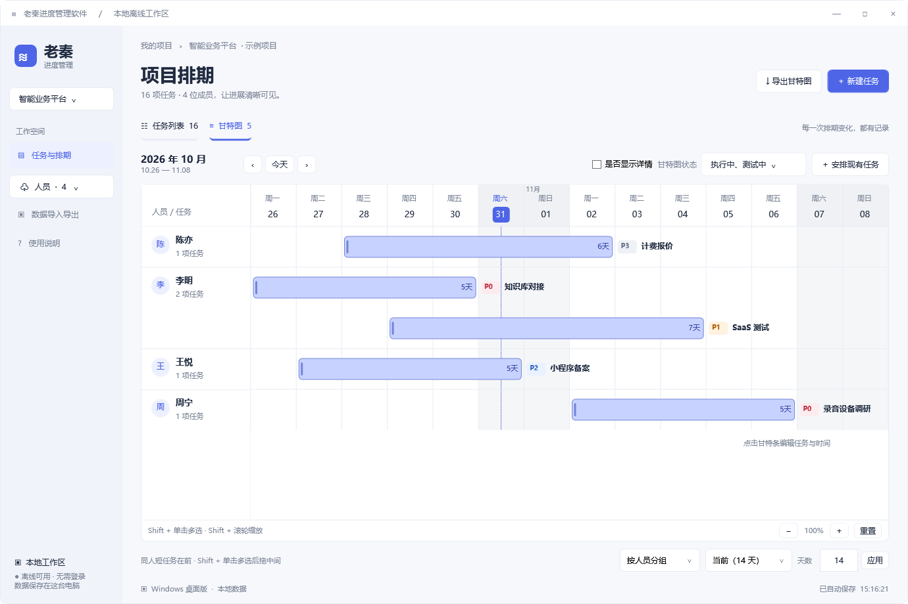
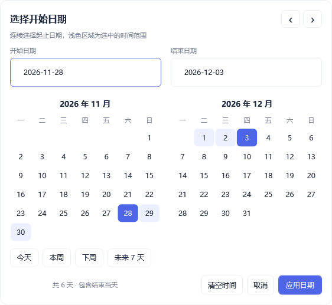
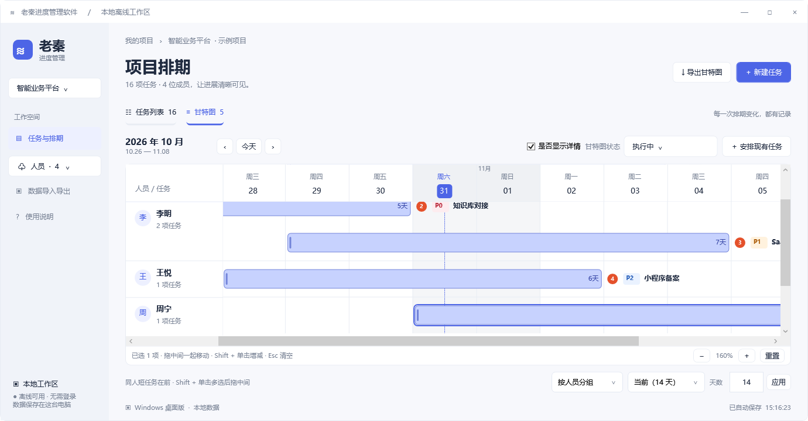
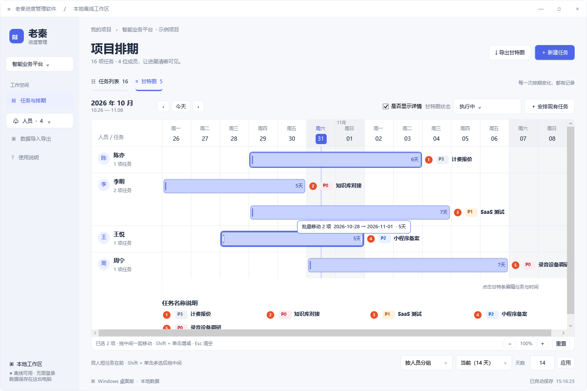

# 使用手册

[返回首页](../README.md) · [构建与验证](DEVELOPMENT.md)

## 项目与任务

通过左侧下拉新建、切换或删除项目。人员档案在项目间共享；删除已关联人员时，任务与历史保留原人员记录，并标注“已删除”。首次附带的示例项目可自行删除，也允许没有任何项目。

新建任务时填写简短名称，长文本放在“备注”。勾选“有备注”展开输入框；编辑已有任务时可直接修改备注。后续补充从“查看”进入详情，点击“追加需求”，每条内容独立记录时间。

任务列表“查看”打开时间线，“编辑”修改任务。“有备注 / 无备注”表示是否填写备注，“X 节点”为时间线节点数，包含创建、追加需求和变更记录。

## 状态、优先级与筛选

| 项目 | 规则 |
| --- | --- |
| 正常流程 | 待讨论 → 待执行 → 执行中 → 测试中 → 已完成 |
| 特殊状态 | 已暂停、已关闭；进度沿用最近一次记录的正常阶段 |
| 优先级 | P0 最高，依次为 P1、P2、P3 |
| 列表排序 | 执行中、测试中、待执行、待讨论、已暂停、已完成、已关闭；再按优先级、创建时间倒序 |
| 同人甘特排序 | 完整计划天数从短到长；同天数再按状态、优先级等排序 |

任务列表支持多选状态、多选优先级和关键词搜索，关键词匹配名称及备注。同类筛选中任意匹配即可，不同类条件共同生效。“全选”表示不限，“清空”表示没有选项，因此无匹配结果。

甘特图默认显示“执行中”。点击唯一的“甘特图状态”下拉，勾选一个或多个状态，也可全选，直接刷新图表和数量。PDF、PNG 沿用这个筛选。

## 日期选择与清空

点击起止日期打开双月日历，连续选择两端，再点击“应用日期”写回表单；取消或点击外部保留原值。支持跨月、反向选择、手动输入，以及今天、本周、下周、未来 7 天。日期按自然日计算，包含结束当天。

新建、编辑任务和甘特图排期均可点击“清空时间”，同时移除两端日期。保存后暂不排期，保留所选状态，原日期记录到时间线。执行中仍须指定负责人；清空日期不会自动改变状态。

## 甘特图浏览

- 顶部日期栏固定，向下滚动任务仍能看到月份、星期和日期。
- 左侧人员列固定，左右滚动不会带走姓名；同组任务向下滚动时姓名吸顶，进入下一组后切换。
- 普通滚轮上下滚动，底部横向滚动条查看左右日期。
- `Shift + 滚轮` 缩放，范围 25%～400%，以鼠标所在日期为中心；也可使用缩放和重置按钮。
- 底部可选 7 天、15 天、本月，或输入 1～3660 天后点击“应用”。

任务标识统一在条后，顺序为“编号（开启详情时）、优先级、名称”。条内显示天数。周末为浅灰背景，任务条按状态显示填色、边框和起点强调线。

“是否显示详情”同时控制预览及 PDF、PNG 的编号和完整名称说明。说明位于图下，按等宽列排列，编号纵向对齐，长名称在格内换行。预览会扩展右侧名称画布，可横向滚动查看。

## 拖动修改排期

| 手势 | 效果 |
| --- | --- |
| 单击任务条或名称 | 打开排期编辑窗口 |
| 拖左边缘 / 右边缘 | 分别调整开始 / 结束日期，另一端不变 |
| 拖中间 | 整体移动，保留计划天数 |
| `Shift + 单击` | 增减选择，选中条显示描边 |
| 拖任一选中条中间 | 整组移动相同天数，保留相对间隔 |
| `Esc` | 拖动中取消，未拖动时清空选择 |

按天吸附，最短一天。拖动时只显示草稿，松开后统一保存，每项任务分别记录原计划、新计划和操作时间；状态、负责人、优先级及备注不变。

多选后拖边缘只调整当前任务。靠近视口左右边缘可自动横向滚动，被视图裁切的边界不会被误认为真实起止点。失去鼠标捕获会取消；批量保存时任一任务日期已变化，则整组不写入。

切换任务列表保留选中项，筛选隐藏的任务会退出选择，切换项目清空选择。点击空白处也可清空选择。

## 排期编辑窗口

单击任务条打开窗口，先按状态筛选，再搜索并多选已有任务。“全选”只选择匹配结果。负责人、日期及指定的状态、优先级应用到全部选中任务；状态和优先级默认保持原值。

保存时，选中任务替换当前甘特条。原任务若未再次选中，会退出本次排期，但任务、原日期及历史保留。同一任务只有一个当前甘特条，“安排现有任务”可重新纳入已退出的任务。

## 导出 Excel

1. 在任务列表设置状态、优先级及关键词，点击“导出 Excel”。
2. 首次默认勾选全部字段，可取消、全选或全不选。
3. 拖动左侧 `≡` 调整字段顺序，从上到下对应 Excel 从左到右。
4. 选择保存位置。成功导出后记住顺序及勾选，重启后仍有效；“恢复默认”恢复全部字段及原顺序。

导出覆盖全部匹配任务，包含所有分页；无筛选则导出当前项目全部任务。取消弹窗或保存窗口不生成文件，不改变筛选。

默认 13 列：序号、所属项目、任务名称、优先级、状态、负责人、计划开始日期、计划结束日期、是否纳入当前排期、备注、追加需求、创建时间、最近更新时间。

追加需求按时间逐条占行，同一任务的基础字段纵向合并，不跨任务合并。不选追加需求时普通任务一行一条，超长说明自动续行，未记录的日期和时间留空。状态用连线圆点显示流程；报告头与表头不冻结。

## 导出甘特图

| 格式 | 布局 |
| --- | --- |
| PDF | 一个文件、一张连续页面，页面尺寸随完整甘特图延展 |
| PNG | 一张完整高清图片，默认 3 倍无损分辨率 |
| XML | 当前项目完整数据，不受甘特状态筛选影响 |

PDF、PNG 直接保留当前甘特图的日期范围、状态筛选、分组、任务顺序、缩放列宽和详情设置。滚动区域内的任务和右侧完整名称全部保留，选中任务不会缩小导出范围。导出窗口只需选择文件格式；如需调整内容，先在甘特图上调整。

PDF 和 PNG 均只生成一个文件，不拆页或打包 ZIP，默认使用 3 倍无损分辨率。大图会适当降低像素密度，布局保持一致；若原始尺寸仍超过单边 16000 像素或总计 6000 万像素，提示缩小日期范围或减少显示的任务后重试。日期范围最多十年。PDF 为高清图像，不提供文字搜索或复制；XML 并非 Microsoft Project 专用格式。

## 备份、迁移与删除

默认目录：`%LOCALAPPDATA%\LaoQinProgress`，可从“数据导入导出”打开。

“导出全部数据”保存全部项目、人员、任务、排期及时间线的 JSON，可复制到其他电脑导入。导入覆盖当前数据，先校验文件，并在 `backups/` 保存导入前的独立备份。

`data.json.bak` 只保留上一次成功保存的数据。主数据损坏或缺失且备份有效时自动恢复，损坏文件另存为 `damaged-*.json`。首次发现旧版 `Xucheng` 目录时可自动迁移，原目录保留。

删除任务会删除其时间线，删除项目会清理该项目全部任务、排期及时间线。共享人员和独立备份保留，允许删除最后一个项目。长期备份请手动导出完整 JSON。

## 常见问题

**任务为什么不在甘特图中？** 检查项目、状态筛选、负责人、完整日期和排期归属。任务日期在当前视图外时可翻周或增加天数。已完成视图包含有完整日期的已完成任务。

**怎样暂时撤销计划？** 编辑任务或排期时清空时间后保存。任务与状态保留，原计划进入时间线。

**导出包含滚动后才能看到的内容吗？** 包含。当前日期范围和筛选下的完整甘特图会放在一个文件中，PDF 为一张连续页面，PNG 为一张完整图片。

**能否云同步？** 本软件为本地离线工具，无服务器或自动云同步；跨电脑使用完整 JSON 迁移。

## 快捷键

| 快捷键 | 操作 |
| --- | --- |
| `Ctrl+N` | 新建任务，无项目时先建项目 |
| `Ctrl+E` | 导出甘特图 |
| `Shift + 单击` | 甘特图增减多选 |
| `Shift + 滚轮` | 甘特图缩放 |
| `Esc` | 取消拖动或清空选择 |
